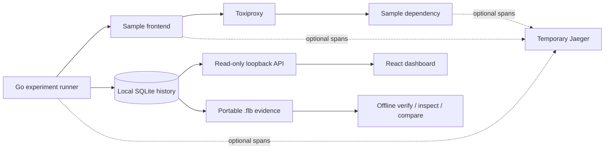
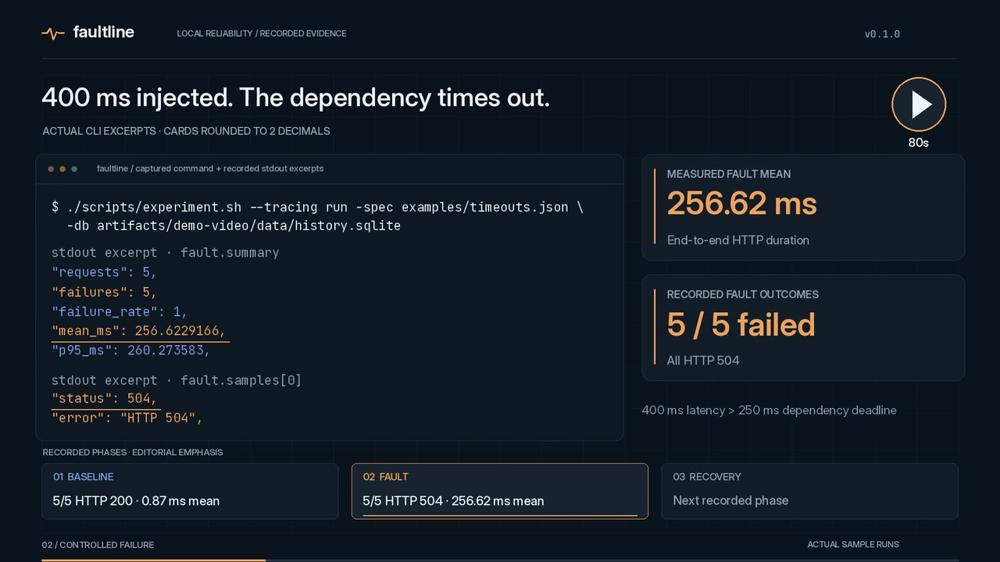
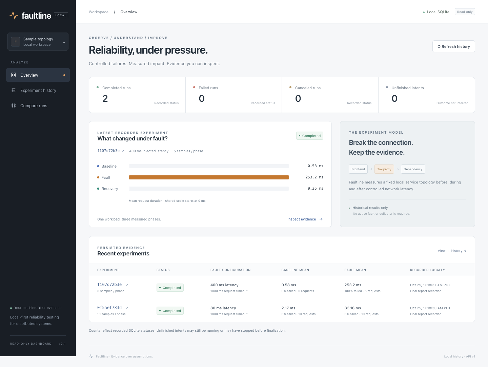

# Faultline

Local-first reliability experiments with portable, inspectable evidence.

A timeout is more useful when you can reproduce the injected fault, see the actual
requests and traces, confirm recovery, and hand the recorded results to someone
else. Faultline does that for a small containerized microservice topology: measure
baseline traffic, inject owned dependency latency, measure failures, remove the
fault, and measure recovery.

Go powers the bounded experiment engine, OpenTelemetry correlation, SQLite history
and read-only loopback API. React presents real persisted measurements. Portable
`.flb` bundles carry raw observations, validated summaries, configuration and
recorded provenance; a standalone tool verifies, inspects and compares them offline.



Faultline is early open-source developer tooling, not production chaos infrastructure.
It targets only its isolated sample services. It has no arbitrary targets, browser
fault control, hosted service, AI analysis or statistical-significance claims.
Toxiproxy emits no spans. Temporary Jaeger traces are not included in bundles.

## Watch the Demo

See Faultline inject dependency latency, capture HTTP 504 failures, verify recovery,
and compare portable evidence — all in 80 seconds.

[](https://github.com/user-attachments/assets/4fcc2604-4000-4d26-87f4-30af3e5577cc)

**[Watch the 80-second demo](https://github.com/user-attachments/assets/4fcc2604-4000-4d26-87f4-30af3e5577cc)** · Caption-driven; no audio required.

The bundle comparison is `descriptive_only`: recorded configurations differ, and
no causality or statistical significance is claimed.

## Installation and first use

Check the repository's [Releases page](https://github.com/raimbekalish/faultline/releases)
for actual download availability; this documentation does not announce publication.
The v0.1.0 [installation/demo](docs/install.md) supports reviewed source and published
packages; [release notes](docs/releases/v0.1.0.md) label historical qualification.
Local package qualification is recorded in [release preparation](docs/release.md). Do not download binaries from an assumed
release URL. A package already built from reviewed source can be extracted into a
new directory, then used without installing build tools:

```sh
./faultline-bundle --version
./faultline-bundle verify /path/to/run-a.flb
./faultline-bundle inspect /path/to/run-a.flb
./faultline-bundle compare /path/to/run-a.flb /path/to/run-b.flb
```

Only this portable evidence workflow is independent of Docker, SQLite, Jaeger and
network access. Full experiments require local Docker/Compose and the source
wrapper. The native CLI/dashboard packages embed SQLite; build them with CGO/C,
but use no system SQLite at runtime. A prebuilt dashboard needs no Node at runtime.

| Component | Build prerequisites | Runtime requirements |
| --- | --- | --- |
| `faultline-bundle` | Go; CGO disabled | Matching OS/CPU, regular `.flb` files |
| Native CLI/history/export | Go and C compiler | Matching OS/CPU, local database/filesystem |
| Dashboard | Go/C plus Node/npm for assets | Native binary + matching assets + existing SQLite history |
| Full experiments | Pinned container builds via wrapper | Docker/Compose, Git, POSIX shell, local Unix socket |

**Runtime-tested candidate targets:** offline macOS ARM64 natively, macOS AMD64 via
Rosetta 2, Linux ARM64 in Docker's Linux VM, Linux AMD64 via Docker emulation.
The native macOS ARM64 CLI/dashboard candidate is separately qualified on macOS
26.6.2 and embeds a 26.0 minimum; it is not recommended as a primary first-release
asset. All macOS executables lack Developer ID signing/notarization and can be
blocked by Gatekeeper, including the offline tool. Emulation is not an
Intel hardware or broad OS-version qualification. Windows cross-compilation was
evaluated but runtime behavior is unverified and unsupported. See the
[full matrix and limitations](docs/release.md#platform-evidence).

## Engineering documentation

- [Candidate packages, platform evidence and release checklist](docs/release.md)
- [Security boundary and disclosure](SECURITY.md)
- [Architecture](docs/architecture.md)
- [Decisions](docs/decisions/0001-local-vertical-slice.md)
- [Roadmap](docs/roadmap.md)
- [Contributor instructions](AGENTS.md)
- [Report format and measurement limits](docs/reports.md)
- [Validation record](docs/validation.md)
- [Distributed tracing and failure correlation](docs/tracing.md)
- [Specifications, persistent history and recovery](docs/history.md)
- [Local dashboard, API and browser verification](docs/dashboard.md)
- [Portable evidence and environment provenance](docs/evidence.md)

## Run an experiment

Requirements: Docker Engine/Desktop with Compose v2 or later, Git, and a POSIX
shell on macOS or Linux. Docker must be running through a local Unix socket;
the wrapper refuses remote endpoints. A host Go installation is optional. The first run
downloads pinned Go and Toxiproxy images and builds two small static binaries.

```sh
git clone https://github.com/raimbekalish/faultline.git
cd faultline
mkdir -p artifacts
./scripts/experiment.sh > artifacts/report.json
```

The script starts the sample app, runs ten sequential requests per phase with
100 ms injected latency, writes JSON to stdout, and tears down its own stack.
Build/status messages and a short comparison go to stderr. Reports stay local
and are ignored by Git.

```text
runner → frontend → Toxiproxy → dependency
   └──────────────→ control API
```

Observe dependency timeouts (the frontend has a 250 ms deadline):

```sh
./scripts/experiment.sh -samples 5 -latency 400ms > artifacts/timeouts.json
```

The fault phase should return HTTP 504 failures while baseline and recovery
succeed. Measured failures are a valid experiment outcome; setup, baseline,
recovery, cancellation and cleanup errors return a nonzero exit status.

CLI options: `-samples` (1–100 per phase), `-latency` (1ms–5s), and
`-request-timeout` (10ms–5s). Durations must use whole milliseconds. Every run
has a two-minute execution deadline plus a separate five-second cleanup budget.
Large workloads may end with a partial report when that deadline is reached.

## Test

Run all unit and integration tests with the Go race detector against real
Toxiproxy, including latency, timeout failures, recovery and active-fault
cancellation:

```sh
./scripts/experiment.sh test
```

With Go 1.26.8, a C compiler (CGO enabled) and Python 3.10+, `make check` runs formatting verification, vet and unit
race tests, plus shell endpoint-selection regressions. The shell checks can run
alone with `sh scripts/test-wrapper.sh`. Without host Go:

```sh
docker build --target dev -t faultline-dev .
docker run --rm --network=none --cpus=2 --memory=1g faultline-dev \
  sh -c 'test -z "$(gofmt -l cmd internal)" && go vet ./... && go test -race -count=1 ./...'
```

The integration build tag is intentionally opt-in: `go test ./...` alone does
not prove network injection. No GitHub Actions or hosted CI is configured.

## Reproducible runs and history

```sh
./scripts/experiment.sh run -spec examples/latency.json
./scripts/experiment.sh run -spec examples/latency.json
./scripts/experiment.sh history list
```

Specification runs default to local `artifacts/faultline.sqlite`. Use `-db` for a
custom path or to opt legacy flag-based runs into persistence. `history show`
inspects a listed ID; `history compare` returns phase deltas for two completed
runs. Queries start no sample/tracing services. Specs reject unknown fields,
duplicates, unsupported versions and workload overrides. Existing ephemeral
commands and schema-1 stdout reports retain their behavior. History rejects stored
summaries or comparisons inconsistent with their underlying raw samples.

History commits an intent before execution and the complete/failed/canceled
report after fault cleanup. A failed final write leaves an unfinished intent and
returns an error. Unfinished entries do not imply a known failure cause. Trace
IDs survive as references, while transient Jaeger data does not. See
[history commands and durability limits](docs/history.md) before relying on storage.

## Local reliability dashboard

Inspect actual SQLite history: recorded-status counts, searchable runs,
baseline/fault/recovery charts, raw observations, historical trace references and
comparisons of completed runs. Experiment services and Jaeger can be stopped.



Actual persisted experiments, viewed through the packaged dashboard during Chrome
validation; this is recorded evidence, not frontend fixture data.

With Node 22.12+, Go 1.26+ and a C compiler installed:

```sh
# Generate history if needed; its isolated sample stack tears down afterward:
./scripts/experiment.sh run -spec examples/latency.json

# Build and serve UI + API on one ephemeral loopback origin:
./scripts/dashboard.sh -db artifacts/faultline.sqlite
```

Open the printed `http://127.0.0.1:…` URL. Ctrl-C stops the server; it also expires
after one hour by default. The dashboard has no fault execution or Docker access.
See [dashboard commands, API and limitations](docs/dashboard.md).

## Portable evidence

Export a finalized run and inspect it offline without Docker, SQLite, Jaeger or
network access. Build the native tools once, then use a listed run ID:

```sh
make cli offline
./artifacts/bin/faultline bundle export -db artifacts/faultline.sqlite -out artifacts/run.flb RUN_ID
./artifacts/bin/faultline-bundle verify artifacts/run.flb
./artifacts/bin/faultline-bundle inspect artifacts/run.flb
./artifacts/bin/faultline-bundle compare LEFT.flb RIGHT.flb
```

Copy the platform-appropriate verifier with the bundle for offline use. The
archive preserves actual reports/specifications and includes checksum metadata;
checksums do not establish authenticity. New runs record allowlisted environment
facts; missing historical provenance stays unavailable. Run details also offer a
same-origin download. See [format, safety and portability limits](docs/evidence.md).

Offline comparison validates both inputs, reports right-minus-left phase changes,
and distinguishes matching recorded conditions, descriptive-only differences and
non-comparable partial/failed evidence. Missing provenance stays unknown; relative
changes with zero references remain unavailable. It makes no significance or
causality claim. See [comparison rules and examples](docs/evidence.md#offline-comparison--result-schema-1).

## Optional distributed tracing

```sh
./scripts/experiment.sh --tracing -samples 5 -latency 80ms
./scripts/experiment.sh --tracing test
./scripts/experiment.sh --tracing evidence > artifacts/evidence.json
```

The evidence command runs 80/400 ms faults and saves real observations, correlated
span summaries and raw Jaeger responses. Add `--view` after `--tracing` to publish
the query UI on a random loopback port for five minutes; stderr prints its URL.
Ingestion and administrative endpoints stay internal. Default experiments start
no Jaeger service and create no SDK provider. See [tracing](docs/tracing.md) for
exact viewing commands, bounded export, interpretation, and overhead measurement.

## Safety and cleanup

Only the checked-in sample topology is supported; arbitrary target URLs are
not accepted. Each invocation gets a unique Compose project and internal network.
No host ports are published by default; explicit `--view` publishes only the
loopback Jaeger query/UI port. Containers do not receive the Docker socket, host
networking or elevated privileges. Runtime services use non-root users, read-only
filesystems, dropped capabilities and CPU/memory/process limits.

The engine deletes its uniquely named proxy under a fresh timeout even when a
request is canceled or a control response is lost. Deleting the proxy also removes
its fault. It never calls Toxiproxy's global reset. The script then removes only
its project's containers/network and image tags. Shared base images and build
cache remain for subsequent runs.

Ctrl-C/SIGTERM request cleanup. SIGKILL, Docker failure, or a host crash can leave
resources behind. If interrupted forcibly, use `docker compose ls -a` to identify
the exact `faultline-…` project, then run:

```sh
FAULTLINE_PROJECT=<exact-project-name> docker compose -p <exact-project-name> \
  -f deploy/compose.yaml -f deploy/compose.tracing.yaml -f deploy/compose.ui.yaml \
  down --volumes --remove-orphans --timeout 12
```

Use all three files even if tracing was disabled: this also selects any optional
Jaeger container and viewer network left by an interrupted run. Teardown does not
create missing services. Never substitute another project's name.
The control API has no authentication;
isolation assumes a trusted local Docker host. Do not expose it or use production
services. These tests show a small causal latency/timeout effect, not production
capacity or statistical significance.

## License

[MIT](LICENSE)
