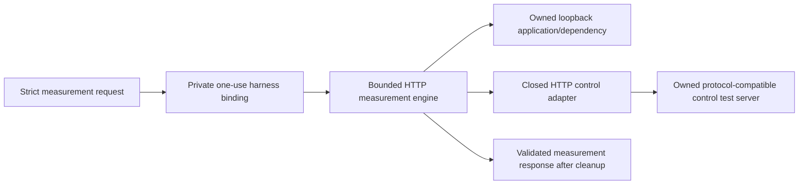

# Internal worker measurement protocol — Unreleased M8B3B

This completes a **local testable** message→measurement→control→result adapter.
Production remains `lab plan` and the dedicated `lab-worker` entrypoint remains
preflight-only. There is no Docker mutation driver, actual runtime binding,
measurement CLI, catalog build or real Toxiproxy integration. See
[ADR 0013](../decisions/0013-worker-protocol-scoped-control.md) and the unchanged
[measurement/result semantics](custom-worker-measurements.md).



The test server implements API-shaped control and handler delay. It does not proxy
packets, run Toxiproxy, qualify Docker isolation or certify resource absence.

## Request schema 1

Exactly these seven fields are accepted:

- `schema_version`: integer 1;
- `kind`: exactly `faultline-worker-measurement-request`;
- `launch_id`: existing `faultline-lab-<32 lowercase hex>` form;
- `run_id`: existing `faultline-<32 lowercase hex>` form;
- `specification`: the existing exact schema-1 sample-count/latency/timeout spec;
- `specification_sha256`: recomputed from the existing canonical spec serializer;
- `tracing`: exactly `off`.

No URLs/addresses, file paths, revision claims, commands, environment maps,
Compose input, runtime identities, secrets or plugin settings exist. Shared strict
JSON validation rejects unknown/duplicate/escaped/case-ambiguous keys, invalid
Unicode, null/omitted required fields, invalid numbers and excess nesting. Typed
spec validation rejects unsupported versions and out-of-range configuration.
Deterministic encoding uses fixed struct-field order, no maps/ambient capture.

A private `harnessBinding` fixes the validated configuration, explicit source
revision and two distinct loopback numeric listeners. The internal adapter
revalidates input against this binding before an atomic one-use consume and any
HTTP request. Invalid input/binding has no side effects or output. Concurrent
requests cannot both consume one binding; failed output cannot replay it. No
binding is deserializable. Reconstructing a test object is not durable RUN
permission: host consumption/ledger/lease requirements remain separate.

## Example request (test-owned session only)

These are test-assigned logical IDs and an actual canonical spec hash. This is a
data example, **not a public execution command**; preflight deliberately rejects it.

```json
{
  "schema_version": 1,
  "kind": "faultline-worker-measurement-request",
  "launch_id": "faultline-lab-22222222222222222222222222222222",
  "run_id": "faultline-33333333333333333333333333333333",
  "specification": {
    "schema_version": 1,
    "samples_per_phase": 3,
    "latency_ms": 80,
    "request_timeout_ms": 1000
  },
  "specification_sha256": "159e458f5f546e9946a1c4a8adb3327946baaf9cb8a535e1f62cdd5f53f9ebe3",
  "tracing": "off"
}
```

## Response schema 1

The envelope has exactly `schema_version: 1`,
`kind: "faultline-worker-measurement-response"` and `result`, containing the
unchanged `faultline-custom-worker-result` schema-1 record. Decode requires the
expected request and trusted revision, exact identity/configuration/hash match,
strict envelope/nested fields and existing raw-sample-derived summary validation.
The request never gets to assert the worker source revision.

Missing/partial/canceled observations remain explicit. `runtime_qualified` stays
false; `whole_lab_cleanup` stays unavailable. Complete means only the worker
phases and its acknowledged/verified fault removal succeeded. It is not a host
cleanup receipt, Docker certificate, sample report, SQLite record, `.flb` bundle
or gate input. Existing decoders reject it; no old schema/output changes.

Encode preserves identical recorded measurements deterministically. Real repeated
requests have timing variance and do not promise identical bytes. Operational
failure/cancellation returns an error **and a validated response**, after cleanup.
Invalid request yields no response. Output failure returns a fixed redacted error;
the in-memory result remains available but truncated stream bytes are not evidence.

## Closed controller contract

The implementation targets the fixed logical host `toxiproxy-control:8474`, dialed
only through the private explicit loopback binding. Paths derive from the exact
validated run ID, never a prefix search. Launch ID is checked against the session;
Toxiproxy has no launch-nonce/immutable toxic-ID field, so this is not API-level
authentication or historical creation attestation.

Only these operation forms exist:

| Operation | Expected response and validation |
| --- | --- |
| GET `/proxies/<run_id>` | HTTP 200 JSON: exact name, listen `0.0.0.0:8666`, upstream `dependency:8080`, enabled true and zero/one expected toxic; no extra fields/toxics. |
| POST `/proxies/<run_id>/toxics` | HTTP 200 JSON for exactly `faultline-latency`, type latency, downstream, toxicity 1, configured integer milliseconds and jitter 0. |
| DELETE `/proxies/<run_id>/toxics/faultline-latency` | HTTP 204, followed by separate exact-proxy observations. |

The [2.12 API implementation](https://github.com/Shopify/toxiproxy/blob/v2.12.0/api.go)
and [toxic wire fields](https://github.com/Shopify/toxiproxy/blob/v2.12.0/toxics/toxic.go)
were inspected. No upstream Go dependency was added or binary invoked. Exact
listen serialization and other effective behavior still require real qualification;
unexpected normalization fails closed instead of weakening the profile.

Apply first requires an empty matching proxy. Register uncertainty before sending
one POST. Exact returned metadata acknowledges creation; a fresh matching proxy
read is additionally required before recording applied/starting fault traffic.
Wrong metadata, lost reply, timeout or cancellation remains UNKNOWN. A valid
POST reply followed by a failed read may retain acknowledged cleanup scope, but
never application success without that read.

Removal requires acknowledged creation in this session and another matching
single-toxic read, then at most one DELETE. Never adopt a toxic after lost/malformed
POST just because its name/attributes look expected. Foreign name/type/stream/
attributes/proxy configuration or unexpected additional toxics prevents deletion.
A missing proxy/404 is not absence evidence. Verification needs two successful
matching proxy reads with consistently empty toxics. Presence, disagreement or
communication errors remain explicit. Lost/non-successful removal cannot become
confirmed cleanup even if later reads are empty. No automatic retry/reconciliation.

Normal flow is seven HTTP requests: read, POST, read; read, DELETE; read, read.
There is no proxy creation/deletion/update, global list/reset/populate, generic
method/path API or user URL. The adapter enforces a seven-request ceiling and
refuses concurrent method entry. Names and matching API profiles alone do not
prove that an arbitrary server is owned: only the test harness's controlled server
lifetime is established here. Actual runtime binding/exclusive control/continuity
and lost-response reconciliation remain prerequisites before any production use.

## Budgets and cancellation

- Measurement input ≤8192 bytes; response ≤132096 bytes (result ≤128 KiB).
- Cooperative decoding budget ten seconds; shared parser nesting bound 32.
- Control HTTP timeout two seconds; 8 KiB headers and 32 KiB response body limit.
- No environment proxy, redirects, compression, reused connections or hidden retry.
- Existing 120-second work, 20/five-second readiness, 320 maximum data requests,
  five-second apply and independent five-second cleanup budgets are unchanged.
- Response writing happens after cleanup, even when work is canceled. A bounded
  single write is checked for errors/short output; it never authorizes replay.

A context check cannot interrupt an arbitrary blocked Reader/Writer or stalled
kernel. The future IPC owner must close/deadline its own streams; no production
pipe attachment is implemented here. A controller must honor context. These are
cooperative deadlines, not unconditional wall-clock or cleanup guarantees.

## Local verification and interruption

```sh
go test -race -count=1 -v ./internal/labworker -run 'Test(Measurement|Controller|ScopedControl|StrictMeasurement|CanceledApply)'
go test -race -count=1 ./internal/labprotocol ./cmd/lab-worker
```

The end-to-end harness validates real requests before work, sends actual HTTP
control messages, changes dependency handler delay and records real HTTP data
traffic. 80 ms and 400 ms runs exercise successful calls and actual 504 responses
from a 250 ms application dependency deadline, followed by recovery. This is
**not** real Toxiproxy network fault injection, independent-container conformance,
Docker DNS/isolation or a statistical/causal benchmark.

Cancellation after acknowledged apply demonstrates removal under the fresh cleanup
context and a valid canceled response. Cancellation/lost reply during apply leaves
application/removal uncertain and does not adopt the mock toxic. A lost DELETE
can record observed absence while cleanup remains unconfirmed. Output-write
failure occurs after cleanup and retains consumed binding state.

Actual owned Go test subprocesses exercise SIGTERM and SIGKILL. Cooperative SIGTERM
produces a canceled response with confirmed mock removal. SIGKILL produces no
worker response and leaves the mock toxic present. The parent records that absence
of evidence as an interruption observation, not a fabricated worker result. Parent
test cleanup closes only its owned mock servers. Real worker death still requires
host-side exact-resource cleanup; process exit never certifies it.
